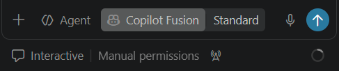
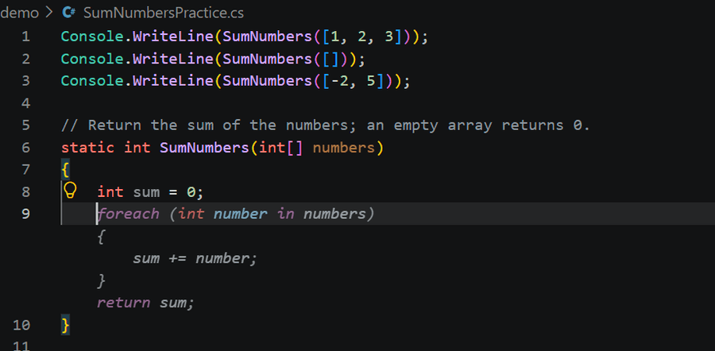
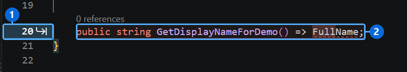
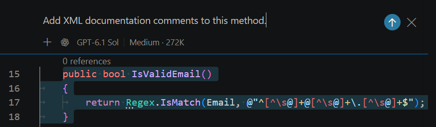
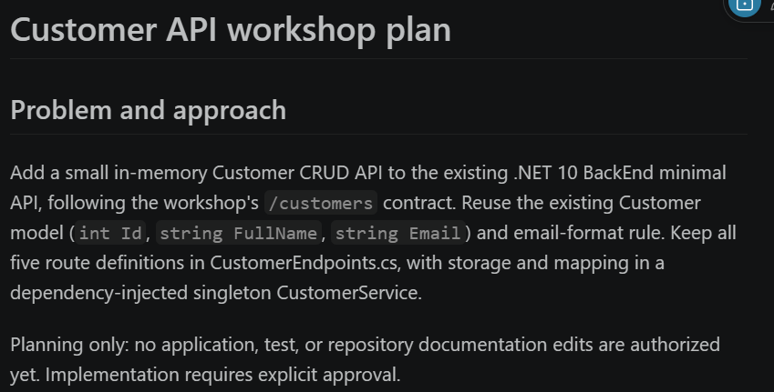

# Using GitHub Copilot with C# in VS Code (Copilot harness)

> **Current as of 18 November 2026** — VS Code 1.146, .NET 10 (LTS), GitHub Copilot **Copilot harness**.
> A beginner-friendly, hands-on refresh of Microsoft's
> [Using GitHub Copilot with C#](https://github.com/microsoft/Mastering-GitHub-Copilot-for-Paired-Programming/tree/main/Using-GitHub-Copilot-with-CSharp)
> module, rewritten for **local VS Code only** (no Codespaces).

> [!IMPORTANT]
> The **Local harness is deprecated** (VS Code 1.146) and will be **removed in February 2027**
> ([changelog](https://github.blog/changelog/2026-11-16-vs-code-retires-the-local-harness-in-february-2027/)).
> Every exercise here uses the **Copilot harness**, which has been the default for new sessions since VS Code 1.143.
> It runs commands and edits files on your PC.

## What you will learn

1. Set up VS Code, .NET 10, and GitHub Copilot on your own computer.
2. Start a chat session that uses the **Copilot harness**, and pick an agent, model, and permission level.
3. Use both types of **inline suggestions**: **ghost text suggestions** (from a comment or method stub) and **next edit suggestions (NES)**.
4. Explain and document code with **inline chat**.
5. Ask questions about a codebase, **plan** a change, then let an **agent** build and test it.
6. Teach Copilot your team's conventions with **custom instructions**.
7. (Optional, preview, if MCP is allowed) Bring in Microsoft Learn docs with a **Copilot connector** or an **MCP server**.

**Time:** budget 2 hours including setup (a planning allowance, not a measured class duration). **Level:** beginner (basic C# and terminal).

## The sample app

This repository contains a small, runnable .NET 10 solution that every exercise uses:

The forecasts are randomly generated **synthetic data**, not a live weather service. The Customer exercises must also use fictional people and addresses.

| Project | What it is | URL when running |
| --- | --- | --- |
| `src/BackEnd` | ASP.NET Core minimal API with a 5-day forecast for Brisbane, Sydney, and Melbourne, plus interactive API docs (OpenAPI + Scalar) | http://localhost:5100/weatherforecast and http://localhost:5100/scalar |
| `src/FrontEnd` | Blazor Web App (interactive server) that shows the forecasts in a table | http://localhost:5200 |
| `tests/BackEnd.Tests` | xUnit tests for the API | `dotnet test` |

---

## Part 0 — Prerequisites (do this before the session)

> [!NOTE]
> **Before you start (company users)**
>
> 1. Use the Copilot account your company assigned. Ask your admin to confirm Copilot agents, models, and preview features/MCP are allowed.
> 2. C# Dev Kit has its own license terms for company use; check with your admin, or use the free **C#** extension instead.
> 3. Copilot runs commands and edits files on your PC, but your prompts and code context are sent to the hosted AI model. Use only this sample and made-up data, never passwords, customer data, or company code.
> 4. Always review what Copilot changes before you keep it.

1. A GitHub account with Copilot access (ask your admin if you use a company account).
2. **VS Code 1.146 or later** — <https://code.visualstudio.com/download>. Check with **Help > About**. GitHub Copilot is built into VS Code; you don't need to install a separate Copilot extension.
3. **A .NET 10 SDK (10.0.100 or later)** — <https://dotnet.microsoft.com/download/dotnet/10.0>. It installs side by side with other SDKs. Check in a terminal:

   ```powershell
   dotnet --list-sdks
   ```

   The list must include a `10.0.x` version (10.0.100 or later). `global.json` selects the newest stable .NET 10 SDK you have installed. Install the **SDK**, not only the runtime; .NET 11 alone does not satisfy this baseline. After opening the repo, `dotnet --version` should report a `10.0.x` version.

   > .NET 8 (used by the original module) reached end of support on 10 November 2026. Use .NET 10 (LTS, supported to November 2028).

4. **C# Dev Kit** (recommended) or the **C#** extension — install from the Extensions view (`Ctrl+Shift+X`).
5. **Git** — <https://git-scm.com/downloads>.

## Part 1 — Get the sample running locally

1. Clone and open the repository:

   ```powershell
   git clone https://github.com/anarchitect/using-github-copilot-with-csharp-vscode.git
   cd using-github-copilot-with-csharp-vscode
   code .
   ```

2. Inspect the repository, then, if you trust it, select **Yes, I trust the authors** when VS Code asks. Agents are restricted in Restricted Mode. Open a dedicated training branch so your work is easy to review:

   ```powershell
   git switch -c training/copilot-basics
   ```
3. Open the integrated terminal (`` Ctrl+` ``) and build and test:

   ```powershell
   dotnet build
   dotnet test
   ```

4. Start the **API** in that terminal:

   ```powershell
   dotnet run --project src/BackEnd
   ```

5. Open a **second** terminal (select **+** in the terminal panel) and start the **web app**:

   ```powershell
   dotnet run --project src/FrontEnd
   ```

6. Open <http://localhost:5200> and select **Weather**. Then open <http://localhost:5100/scalar> to see the API docs.

> **✅ Checkpoint 1:** The unchanged starter reports **15 passed**, the Weather page shows a 15-row table (5 days × 3 cities), and Scalar lists the **Weather** endpoints.
> Stop **both** apps with `Ctrl+C` before exercises that edit or rebuild them. On Windows, running apps can lock build output; after an edit, an old process also serves old code.

For a repeatable HTTP smoke check, stop both apps and run `pwsh -File .\scripts\Test-Smoke.ps1` (PowerShell 7). It starts its own processes, checks the API, Scalar, stylesheet, and server-rendered Weather table, then stops only those processes. Logs are saved under `TestResults\smoke`. It does **not** test browser interactivity or Copilot UI. Ports busy? Stop your own apps or pass `-BackEndPort 15100 -FrontEndPort 15200`.

## Part 2 — Sign in and start a Copilot harness session

1. **Sign in:** select **Sign in to use Copilot** in the Copilot menu in the Status Bar, or use the **Accounts** menu in the Activity Bar > **Sign in with GitHub to use GitHub Copilot**.
2. **Open the Chat view:** `Ctrl+Alt+I`. Start a new chat with `Ctrl+N` while the Chat view has focus.
3. Before sending the first prompt, choose **Copilot** in **Session Target**. Set the other controls below the chat input as follows:

   | Picker | Choose | Why |
   | --- | --- | --- |
   | **Session Target** | **Copilot** | The Copilot harness. It's the default, but check it — do **not** pick *Local*. |
   | **Agent** | **Ask** or **Agent** (each exercise tells you which) | *Ask* answers questions; *Agent* edits files and runs commands. Type `/plan` for planning. |
   | **Language model** | **Copilot Fusion** or an available **Auto** option | Availability depends on your account and policy; this chat choice does not select the ghost-text completions model. |
   | **Permissions** | **Manual permissions** | Review requested actions and any approval scope. Existing approvals and read-only actions can run without a new prompt. |

   

   *Find the agent, model, and permission controls below the prompt. Screenshots show VS Code 1.146; your available models and layout may differ.*

> **✅ Checkpoint 2:** The new session uses **Copilot**. Ask: `What can you help me with in this workspace?` and get a reply that mentions the BackEnd and FrontEnd projects. After the first prompt, the chat title's **Copilot** prefix identifies the harness; the Session Target picker need not remain visible.

> [!TIP]
> Type `/` in the chat input to see the slash commands available in Copilot harness sessions, such as `/plan`, `/compact`, `/fork`, and any installed skills.

---

## Exercise 1 — Ghost text suggestions from a comment (≈10 min)

**Inline suggestions** is the umbrella term. **Ghost text suggestions** complete code at your cursor in dimmed text; **next edit suggestions** propose another edit and its location. Here, start with ghost text.

1. In the Explorer, right-click `src/BackEnd` > **New File**, and name it `Customer.cs`.
2. Type this comment on the first line and press `Enter`:

   ```csharp
   // Create a class for a Customer with Id, Name, and Email, and a method to validate the email format
   ```

3. Pause for dimmed code at the cursor. If nothing appears, open the Command Palette (`Ctrl+Shift+P`) and run **Trigger Inline Suggestion**. Review it, then press `Tab` to accept or `Esc` to dismiss. Repeat on new lines if the class arrives in parts; don't press `Tab` blindly when no suggestion is visible.
4. Hover over the suggestion to see its toolbar. You can also accept the next word with `Ctrl+Right Arrow`. Save `Customer.cs` (`Ctrl+S`) before building.

> **✅ Checkpoint 3:** `Customer.cs` contains a `Customer` class with `Id`, `Name`, `Email`, and an `IsValidEmail()`-style method, and `dotnet build` still succeeds.
>
> Your code will differ from your neighbour's — Copilot's output isn't deterministic. If ghost text remains unavailable, record **"ghost text not observed"**. You can use Agent to create the requested class so later exercises have `Customer.cs`, but that is recovery, not a ghost-text demonstration.

## Exercise 1b — Ghost text suggestions from a method stub (≈5 min)

A **method stub** is a signature with an unfinished body — the C# equivalent of the function-stub example in the [VS Code getting-started guide](https://code.visualstudio.com/docs/editing/ai-powered-suggestions#_getting-your-first-suggestions).

1. In the Explorer, create a new folder named `practice` at the repository root (next to `src` and `tests`). In it, create `SumNumbersPractice.cs` (`practice/SumNumbersPractice.cs`) and enter this starting code. Keep it outside `src` and `tests`: it is a separate .NET 10 file-based app, not part of the Weather solution.

   ```csharp
   Console.WriteLine(SumNumbers([1, 2, 3]));
   Console.WriteLine(SumNumbers([]));
   Console.WriteLine(SumNumbers([-2, 5]));

   // Return the sum of the numbers; an empty array returns 0.
   static int SumNumbers(int[] numbers)
   {
   }
   ```

2. Place the cursor immediately after `{`, press `Enter`, and pause. If needed, run **Trigger Inline Suggestion**. Review the dimmed method body and accept with `Tab`. If only part arrives, press `Enter` and repeat until the method returns a result.

   

   *Solid text is already in the file; the dimmed loop and return are still a suggestion. This capture is partway through completion — your suggestion may use different code.*

3. Save (`Ctrl+S`). In the terminal, from the repository root, run:

   ```powershell
   dotnet run --file .\practice\SumNumbersPractice.cs
   ```

> **✅ Checkpoint 3b:** You observed and accepted ghost text inside the stub, and the output is **`6`, `0`, `3`**, one result per line. A build error before completing the return is expected; an error or different output afterwards needs correcting. If suggestions remain unavailable, record **"ghost text not observed"** and skip this standalone exercise; it is not needed for the Customer API.

Return to `src/BackEnd/Customer.cs` for Exercise 2.

## Exercise 2 — Next edit suggestions (≈5 min)

Next edit suggestions (NES) predict the *next* change you'll need, based on the edit you just made.

Continue with `src/BackEnd/Customer.cs` from Exercise 1. You create this file during that exercise; it is intentionally absent from the starter.

1. Ensure `Customer.cs` has a use of `Name` to update. For example, add `public string GetDisplayNameForDemo() => Name;` inside the class if it has no such reference.
2. Change the **property declaration** from `Name` to `FullName` by typing, leaving the method's reference unchanged. Do not use the symbol-rename command yet.
3. Look for an **arrow in the editor gutter**. Its direction shows where the suggested edit is relative to your cursor; hover over it to see the navigation/acceptance controls.

   

   *1: the NES gutter indicator. 2: the nearby diagnostic underline is a separate signal, not proof of what Copilot will change. Hover or navigate to inspect the proposed edit.*

4. Press `Tab` to jump to the suggestion, review the proposed change, and press `Tab` again to accept it. Save `Customer.cs` (`Ctrl+S`) before building.

> **✅ Checkpoint 4:** You observed and accepted an NES reference update, the rename is applied everywhere in the file, and `dotnet build` succeeds.
> No gutter arrow? Check `github.copilot.nextEditSuggestions.enabled`. Suggestions are not guaranteed. Record **"NES not observed"**, then complete the reference edit manually, or undo the rename and use **Rename Symbol** (`F2`). Save (`Ctrl+S`) and run `dotnet build` so you can continue. That recovery keeps the project compiling; it does not demonstrate NES.

## Exercise 3 — Inline chat (≈10 min)

**Editor inline chat** lets you ask about or change selected code without starting in the Chat view.

1. Select the email-validation method in `Customer.cs`.
2. Press `Ctrl+I` and type:

   ```text
   Explain what this method does and list any email formats it would get wrong.
   ```

   Press `Enter` to submit and read the answer. Close the inline chat with `Esc`.

3. Select the method again, press `Ctrl+I`, type the following, and press `Enter`:

   ```text
   Add XML documentation comments to this method.
   ```

   

   *Select the method, press `Ctrl+I`, and enter the prompt above the selection. Submit it to request the change; the screenshot shows the prompt before submission.*

4. Review the inline diff and select **Keep** (or **Undo**).

> **✅ Checkpoint 5:** The method has a `/// <summary>` comment.

> [!NOTE]
> Use the plain-English prompts above rather than relying on older slash-command lists. Editor inline chat is distinct from a Copilot harness session in the Chat view. If `Ctrl+I` opens **Ask in Chat** for a file in an active editing session, set `inlineChat.askInChat` to `false` in Settings and try again.

## Exercise 4 — Ask about the codebase (≈10 min)

1. In the Chat view, set the agent picker to **Ask**.
2. Select **Add Context** (or type `#`) and attach `src/FrontEnd/Components/Pages/Weather.razor` and `src/BackEnd/Program.cs`.
3. Ask:

   ```text
   How does the Weather page get its data from the API? Walk me through it step by step for a beginner.
   ```

4. Follow up:

   ```text
   Where would I add a new API endpoint, and where would I add a new page to show its data?
   ```

> **✅ Checkpoint 6:** The answer mentions `WeatherForecastClient`, the `BackEndUrl` setting (`http://localhost:5100`), `WeatherRepository`, and the `/weatherforecast` endpoints. Ask doesn't change any files.

## Exercise 5 — Plan before you build (≈10 min)

1. Set the agent picker to **Agent**, then type:

   ```text
   /plan Add a Customer API to the BackEnd project: GET all, GET by id, POST, PUT and DELETE, stored in memory, with email validation and xUnit tests.
   ```

2. Answer any clarifying questions. When the **Review Plan** card appears, select **Open Full Plan** (sometimes **Open Plan** or **Plan summary**) to read it.

   

   *Review the plan's scope before approving implementation. Your generated wording may differ.*

3. Add feedback if you want changes (for example, *"Keep endpoints in a separate file, not in Program.cs"*), then select **Submit Feedback**.

> **✅ Checkpoint 7:** You have a plan that lists the files to change and how the result will be verified. No application code has changed; a plan file may have been created.

## Exercise 6 — Let the agent build and test it (≈20 min)

1. Stop both running apps with `Ctrl+C`. On Exercise 5's plan card, select **Implement Plan** to start implementation. **Approve Plan Only** approves without running it; if you chose that, switch the mode picker from **Plan** to **Interactive** and ask the agent to implement the approved plan. Alternatively, start a new chat with **Agent** selected and paste:

   ```text
   In the BackEnd project:
   1. Use the existing Customer class and its FullName and Email properties. Add a singleton CustomerService registered with dependency injection that stores customers in memory, generates unique IDs, and handles concurrent requests safely.
   2. Add CRUD endpoints under /customers in a separate CustomerEndpoints.cs file using a route group. Return 400 for an invalid email and 404 when a customer isn't found.
   3. Add xUnit tests in tests/BackEnd.Tests for each endpoint, including the 400 and 404 cases. Isolate each test's in-memory state.
   4. Run dotnet build and dotnet test, and fix any failures.
   5. Finish with a short summary of what you changed.
   ```

2. Watch the agent work. With **Manual permissions**, review approval requests for commands such as `dotnet test`. An action already covered by an approval might not prompt again. Prefer **Allow Once** where offered; deny an inappropriate action.
3. Review the changed files in the chat's changes list. Tracked edits are already saved: **Keep** marks them reviewed; **Undo** reverts them. Inspect the terminal and `git diff` too, because terminal-made changes may not appear in that list.

> **✅ Checkpoint 8:** `dotnet test` passes with more than the starter's 15 tests. Restart the API with `dotnet run --project src/BackEnd`; <http://localhost:5100/customers> returns `[]` or a JSON list. In-memory customers disappear whenever the API restarts; this is a learning app, not durable storage.

> [!TIP]
> Stay on **Manual permissions** for this workshop.

## Exercise 7 — Add a page to the front end (≈10 min)

Stop both apps again before the agent builds. With **Agent** selected:

```text
In the FrontEnd project, add a Customers page at /customers that lists customers from the BackEnd /customers endpoint in a table, with a form to add a customer. Follow the same pattern as WeatherForecastClient and Weather.razor, add a nav link in MainLayout.razor, and run dotnet build.
```

Restart the API (`dotnet run --project src/BackEnd`) and, in a second terminal, the FrontEnd (`dotnet run --project src/FrontEnd`). Open <http://localhost:5200/customers>.

> **✅ Checkpoint 9:** Add a fictional customer (for example, `Alex Example`, `alex@example.com`), refresh and confirm it is still listed while the API stays running. An invalid email must be rejected, not silently saved.

> [!NOTE]
> The FrontEnd is a Blazor **server** app, so the browser never calls the API directly — no CORS setup is needed. If the agent suggests adding CORS, ask it why.

## Exercise 8 — Custom instructions (≈10 min)

Custom instructions are Markdown files that Copilot reads automatically, so you don't have to repeat your conventions in every prompt.

1. Create `.github/copilot-instructions.md` (applies to the whole repository):

   ```markdown
   # Project guidelines
   - This is a .NET 10 solution: an ASP.NET Core minimal API (src/BackEnd) and a Blazor Web App (src/FrontEnd).
   - Use file-scoped namespaces, nullable reference types, and records for DTOs.
   - Add new feature endpoints in *Endpoints.cs files using MapGroup; do not relocate the starter Weather endpoints as an unrelated change.
   - Every new endpoint needs xUnit tests in tests/BackEnd.Tests.
   - Explain changes in simple language; the team is new to C#.
   ```

2. Create `.github/instructions/csharp.instructions.md` (applies only to matching files):

   ```markdown
   ---
   applyTo: "**/*.cs"
   ---
   - Use async/await for actual I/O and pass CancellationToken where available. Do not add fake async wrappers to in-memory work.
   - Prefer guard clauses and return early.
   - Add XML documentation comments to public members.
   ```

3. Use **File > Save All** so both instruction files are saved. Stop both apps, start a **new** chat (Agent), and ask:

   ```text
   Add a GET /customers/search?name= endpoint that searches customers by FullName, with xUnit tests. Do not change the Weather endpoints. Run dotnet build and dotnet test.
   ```

4. Review the diff for a separate endpoints file, appropriate async usage, XML docs, and new tests. To check discovery, run **Chat: Open Customizations** and select **Instructions** in the **Agent Customizations editor**. A listed file does not prove it was included in a request or followed; inspect the actual changes. After testing, restart both apps before trying the new route.

> **✅ Checkpoint 10:** The new endpoint follows your conventions without you mentioning them in the prompt.

> [!NOTE]
> The Copilot harness also reads `AGENTS.md` files. **Prompt files (`*.prompt.md`) aren't loaded in Copilot harness sessions** — convert reusable prompts to [agent skills](https://code.visualstudio.com/docs/agent-customization/migrate-customizations) instead.

## Exercise 9 (optional, preview, if MCP is allowed) — Bring in Microsoft Learn docs

Give Copilot up-to-date .NET documentation. Choose **one** option.

**Option A: Copilot connector (preview, guided connection)**

Skip this if your admin hasn't allowed preview features/MCP. Copilot connectors are **GitHub-managed MCP servers**; they require GitHub.com and, for company plans, the **Editor preview features** policy and relevant service/MCP approvals.

1. Start a new chat with Session Target **Copilot**.
2. Run **Chat: Open Customizations** from the Command Palette (`Ctrl+Shift+P`) and select **Browse**.
3. Choose **Copilot Connectors**, find **Microsoft Learn Docs**, select **Connect**, and complete authorization.

**Option B: MCP server for this workspace**

Create `.mcp.json` in the repository root (this is the Copilot harness format, using `mcpServers`):

```json
{
  "mcpServers": {
    "microsoft-learn": {
      "type": "http",
      "url": "https://learn.microsoft.com/api/mcp"
    }
  }
}
```

Do not substitute `.vscode/mcp.json`: it uses the editor/Local harness format, not this Copilot-native format.

Then ask (Agent):

```text
Using Microsoft Learn, check that my Customer endpoints follow current ASP.NET Core minimal API guidance for .NET 10 and suggest improvements.
```

> **✅ Checkpoint 11:** The chat shows a Microsoft Learn tool call, and the answer links to learn.microsoft.com.

---

## Moving from the Local harness

The Local harness is retiring (removed February 2027, [changelog](https://github.blog/changelog/2026-11-16-vs-code-retires-the-local-harness-in-february-2027/)). As a beginner, you only need to do one thing: in the Chat view, set **Session Target** to **Copilot**. If you have older Copilot customizations, see [Move from the Local to the Copilot harness](https://code.visualstudio.com/docs/agents/run/move-to-copilot).

## Troubleshooting

| Problem | Fix |
| --- | --- |
| No Copilot features or chat | Sign in (Status Bar Copilot menu). Check that `chat.disableAIFeatures` isn't enabled. |
| **Copilot** missing from Session Target | Update VS Code to 1.146+, or ask your admin. |
| Agent can't edit files or run commands | Trust the workspace (**Workspaces: Manage Workspace Trust**). |
| `dotnet` not found or required SDK not found | Install a .NET 10 SDK (10.0.100 or later), then restart VS Code. |
| Build reports a file in use (`MSB3021` / `MSB3027`) | Stop both apps with `Ctrl+C`, then rebuild. |
| NuGet restore fails on a company network | Ask your admin for the approved NuGet feed/proxy. |
| Weather page says it can't reach the API | Start `src/BackEnd` first (port 5100). |
| Port already in use | Stop your own app with `Ctrl+C`. If you change the API port, also update `BackEndUrl`. |
| No ghost text | Run **Trigger Inline Suggestion**. Check `github.copilot.enable` for C# and your Copilot allowance. |
| Agent asks for approval too often | Read each request and its scope. Keep **Manual permissions**; existing approvals and read-only actions need not prompt again. |
| Chat gets slow or loses track in a long session | Type `/compact`, or start a new chat. |
| Connectors don't appear in **Browse** | Check Session Target is **Copilot**; skip if your admin blocks preview features/MCP. |

## Quick reference

| Action | Windows |
| --- | --- |
| Open the Chat view | `Ctrl+Alt+I` |
| New chat (in Chat view) | `Ctrl+N` |
| Editor inline chat | `Ctrl+I`, then type and press `Enter` |
| Accept / dismiss ghost text | `Tab` / `Esc` |
| Navigate to / accept an NES | `Tab`, review, then `Tab` |
| Request ghost text explicitly | Command Palette > **Trigger Inline Suggestion** |
| Command Palette | `Ctrl+Shift+P` |

## Learn more

1. [Choose an agent harness](https://code.visualstudio.com/docs/agents/run/agent-harnesses)
2. [AI features cheat sheet](https://code.visualstudio.com/docs/agents/reference/ai-features-cheat-sheet)
3. [Manage approvals and permissions](https://code.visualstudio.com/docs/agents/run/approvals)
4. [Plan work with agents](https://code.visualstudio.com/docs/agents/run/planning)
5. [Inline chat](https://code.visualstudio.com/docs/chat/inline-chat)
6. [Custom instructions reference](https://code.visualstudio.com/docs/agents/reference/custom-instructions-reference)
7. [Copilot connectors (preview)](https://code.visualstudio.com/docs/agent-customization/copilot-connectors)
8. [MCP configuration reference](https://code.visualstudio.com/docs/agents/reference/mcp-configuration)
9. [Canvases (preview)](https://code.visualstudio.com/docs/agents/run/canvases)
10. [Inline suggestions: ghost text and next edit suggestions](https://code.visualstudio.com/docs/editing/ai-powered-suggestions)

## Attribution and license

This module is adapted from
[Using GitHub Copilot with C#](https://github.com/microsoft/Mastering-GitHub-Copilot-for-Paired-Programming/tree/main/Using-GitHub-Copilot-with-CSharp)
in [microsoft/Mastering-GitHub-Copilot-for-Paired-Programming](https://github.com/microsoft/Mastering-GitHub-Copilot-for-Paired-Programming),
© Microsoft Corporation, licensed under [CC BY 4.0](https://creativecommons.org/licenses/by/4.0/).
Changes: rewritten for local VS Code and the Copilot harness, updated to .NET 10, restructured into beginner exercises with checkpoints, and outdated steps removed.
The sample app is an original minimal implementation of the Weather API + Blazor scenario used by
[github/dotnet-codespaces](https://github.com/github/dotnet-codespaces).

1. Documentation: [CC BY 4.0](LICENSE).
2. Sample code: [MIT](LICENSE-CODE).

This is not an official Microsoft or GitHub publication.
